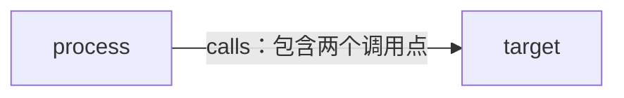

# VRA Function Call Graph v1：对外数据结构

状态：**已接入 `api.generate_call_graph()` 和 `run.py` 整图导出模式。**转换及校验由 `graph_export.py` 完成，现有匹配和目标查询规则保持不变。调用方法见 [PROJECT_API.md](PROJECT_API.md)。

本规范服务于“给定一个选定配置的 C 项目，返回函数调用图”。它不是新的通用图标准，也不宣称符合完整 CPG 或可直接导入 Graphology。

## 1. 一张图里有什么

```text
Graph
├── metadata      这次分析的项目、前端、语言、构建配置
├── nodes         具体函数定义
├── edges         去重后的函数调用关系
├── call_sites    每一次调用的位置、目标状态和匹配依据
└── diagnostics   配置或解析问题
```

核心约定：**节点表示函数定义，边从调用者指向被调用者；一次调用点和一条函数关系边是不同对象。**

例如：

```c
void target(void) {}

void process(void) {
    target();
    target();
}
```

得到 2 个节点、1 条关系边、2 个调用点：



对应的完整示例：[call_graph_v1.json](examples/call_graph_v1.json)。该文件由正式公开接口实际分析示例源码后生成；包含 2 个函数节点、1 条关系边和 2 个调用点。

## 2. 现有规范与我们的选择

| 参考 | 已规定什么 | 对 VRA 的意义 |
|---|---|---|
| [GraphML 官方入门](https://graphml.graphdrawing.org/primer/graphml-primer.html) | 用 XML 表示图、节点、边；节点 ID 唯一，边的 source/target 引用节点 ID | 借用唯一 ID 和端点引用约束；我们目前使用 JSON |
| [Graphology JSON 序列化](https://graphology.github.io/serialization.html) | nodes、edges、attributes 及图选项；节点使用 key，边使用 source/target | 可参考其属性图结构，将来通过适配转换；本提案字段名不同，不可直接声称兼容 |
| [CPG Specification](https://cpg.joern.io/) | 为代码定义不同节点、边和属性，包括 METHOD、CALL、AST、CFG 等层 | 可借鉴代码位置和调用点建模，但当前任务只需要较小的函数调用图 |

CPG 的 CALL 边从调用点 CALL 节点连接到被调用的 METHOD 节点。本规范的 calls 边是函数到函数，调用点单独保存在 call_sites；二者不是同一个模型。

选择：VRA 自己约定代码分析语义，使用常见的 JSON 节点/边结构。图交换形式和“如何确定 C 调用目标”是两回事；采用任何格式都不会自动解决符号匹配。

机器可读约束位于 [call-graph-v1.schema.json](../schemas/call-graph-v1.schema.json)，使用 JSON Schema 2020-12 声明字段形状。JSON Schema 用于约束 JSON 数据应包含哪些字段、字段是什么类型；可参考其[官方说明](https://json-schema.org/understanding-json-schema/about)。

## 3. Graph 字段

| 字段 | 类型 | 含义 |
|---|---|---|
| schema_version | string | 当前为 `1.0.0`；修改字段语义时显式升级 |
| directed | boolean | 固定 `true`，箭头为 caller → callee |
| metadata | object | 项目 ID、版本、前端、语言和选定配置 |
| nodes | array of Node | 所有选定范围内的函数定义，包括没有任何调用的函数 |
| edges | array of Edge | 按函数对去重的 calls 关系 |
| call_sites | array of CallSite | 所有提取到的调用点，包括未解析、间接和歧义调用 |
| diagnostics | array | severity、code、message、location 组成的问题记录 |

metadata 中必需字段：project_id、revision（未知为 null）、frontend（clang/tree-sitter）、languages、build_configuration_id、build_root_target、matching_policy、linker_verified。没有清单时构建 ID/目标可以是 null，不表示所有构建配置等价。matching_policy 固定为 matched_edges_only。

一张图只表示一个分析配置，不合并启用和禁用某个宏的两张图。源码修订号未知时填 null，不伪造。languages 目前只有 c；字段预留不代表已经实现其他语言。

## 4. Node 字段

**一个 Node 表示该分析配置下的一个具体函数定义。**不是一个函数名字，也不是一个 Repo、一个语句或 Tree-sitter 语法节点。

| 字段 | 类型 | 含义 |
|---|---|---|
| id | string | 图内唯一函数标识，不能仅使用函数名 |
| kind | string | 固定 function |
| name | string | 用于阅读和搜索的函数名称，可以重复 |
| language | string | 当前为 c |
| repo | string | 所属源码 Repo |
| location | Location | 函数定义在源码中的位置 |
| translation_unit | string/null | 所属编译单元的相对主源文件路径 |
| is_static | boolean/null | C 内部函数标志；不适用或未知时为 null |
| build_target | string/null | 所选清单中的构建目标名称 |
| build_configuration_id | string/null | 所属选定配置，与本图 metadata 一致 |
| attributes | object，可选 | 前端特有扩展，如函数类型；不改变核心字段含义 |

Location 的字段是 file、line、column：路径相对项目根目录，使用 `/`；行从 1 开始，列为从 1 开始的 UTF-8 字节列。不能把编辑器显示字符列与字节列混用。

id 对消费者是不可拆解的字符串；可以沿用 v3 的文件、位置、TU 与配置组成的标识，不把拼接格式当作消费者必须依赖的协议。不承诺 ID 在源码编辑后仍然稳定。合并不同项目或配置的图时需要重新处理命名空间，不能直接拼接数组。

两个文件的同名 static 函数必须是不同节点；头文件同一 static 定义在两个 TU 中也必须是不同节点。只有声明而没有提供定义的 external_api 不生成虚构函数节点。

## 5. Edge 字段

**一条 Edge 表示 source 函数调用 target 函数的关系。**调用同一目标多次不生成重复关系边。

| 字段 | 类型 | 含义 |
|---|---|---|
| id | string | 图内唯一关系边 ID |
| kind | string | 固定 calls |
| source | string | 调用者的 Node.id |
| target | string | 被调用者的 Node.id |
| call_site_ids | array of string | 支撑这条关系的调用点 ID，至少一个 |
| is_cross_repo | boolean | 两个端点节点的 repo 是否不同 |

去重键为 `(source, target, kind)`。允许自环，例如 recursive → recursive；允许环，例如 a → b → a。

只有 resolution 为 matched 且目标属于 nodes 的调用点进入关系边。matched 包括当前规则得到的唯一构建范围候选，**不等于已证明最终链接采用该实现**；真实依据保留在对应 CallSite 上。

## 6. CallSite 字段

CallSite 不是本图中的函数节点，是独立调用记录。把它单独保存，可避免多次调用的位置丢失，并保留没有确定目标的调用。

| 字段 | 类型 | 含义 |
|---|---|---|
| id | string | 每次调用唯一的 ID |
| caller_id | string | 所属函数的 Node.id |
| callee_id | string/null | matched 时为目标 Node.id，否则为 null |
| callee_name | string/null | 能提取到的目标或指针名字，未知时为 null |
| expression | string | 源码中的调用表达式 |
| location | Location | 调用位置；宏展开优先记录展开使用位置 |
| resolution | string | matched / unresolved / ambiguous / indirect |
| candidate_ids | array of string | 候选函数 ID；仅记录候选不意味着生成边 |
| reason | string | 机器可读的处理原因 |
| evidence | string/null | 编译器引用、构建范围候选等依据 |
| linker_verified | boolean | 是否有最终链接证据；当前 VRA 只能提供 false |
| attributes | object，可选 | 如宏定义位置、展开范围、类型等附加信息 |

状态含义：

- matched：当前规则有唯一目标；候选列表包含该目标，callee_id 非 null。
- unresolved：未找到目标，或缺少判断范围所需的构建信息；可保留工作区候选。
- ambiguous：存在多个无法区分的候选，不任选一个。
- indirect：通过函数指针或回调调用，当前没有解析最终目标。

第一版仍采取单目标匹配策略，不把 ambiguous 或 indirect 的候选扩展成多条“可能边”。以后若支持多目标指针分析，应显式定义新的策略与版本，不能静默改变现有可达性含义。

去重规则：每个调用点只保存一次，但不能仅凭文件/行号去重。`TWICE()` 可能在同一展开位置产生两次调用，必须保留不同 CallSite.id。

## 7. 必须满足的图约束

1. Node.id、Edge.id、CallSite.id 分别唯一；Node.name 不要求唯一。
2. Edge.source/target、CallSite.caller_id、所有非 null callee_id 与 candidate_ids 必须引用本图节点。
3. 同一 `(source, target, kind)` 只存在一条关系边。
4. 每条边至少有一个调用点；引用的调用点必须 matched，且 caller_id/callee_id 与该边端点一致。
5. 每个 matched 调用点恰好属于一条关系边；其他状态的调用点不属于任何关系边。
6. Edge.is_cross_repo 必须与端点 repo 比较结果一致，不能由函数名称推断。
7. 节点配置身份与 Graph metadata 一致，不混合多个构建配置。
8. 从 nodes 和 edges 推导 call_map/reverse_map，不将两份可独立修改的邻接表作为输出的另一份事实来源。

JSON Schema 约束字段形状、类型和部分状态条件；它不能独立完成所有跨记录引用、按 ID 唯一性和去重检查。当前 `graph_export.validate_call_graph()` 使用本契约中实际采用的 Schema 关键字并额外校验上述图约束，不依赖第三方包，也不声称是通用 JSON Schema 引擎。

## 8. 与当前 v3 的对应关系

| 当前内部内容 | 对外输出 |
|---|---|
| functions_by_id 的记录 | nodes |
| call_sites，包括未匹配记录 | call_sites，转换字段名称和位置结构 |
| edges 中逐调用点的记录 | 按 caller_id/callee_id 聚合成 edges，并引用 call_site_ids |
| call_map / reverse_map | 从关系边推导，用于查询；不重复写入规范 JSON |
| parse_errors、link_warnings | 有明确代码和消息的 diagnostics |
| compiler 和 build_context | metadata 及可选扩展信息 |

数据契约已接入转换器、完整图导出和 Python 调用接口。当前 C 分析、候选证据、函数指针限制以及“图上可达不等于运行时执行”的边界保持不变。

旧调用点 ID 共享起始位置时，例如 Tree-sitter 的 `factory()()`，导出层为记录追加稳定序号，并将原始 ID 保留于 `attributes.source_call_id`。不修改内部分析器，不丢弃任何调用记录。
